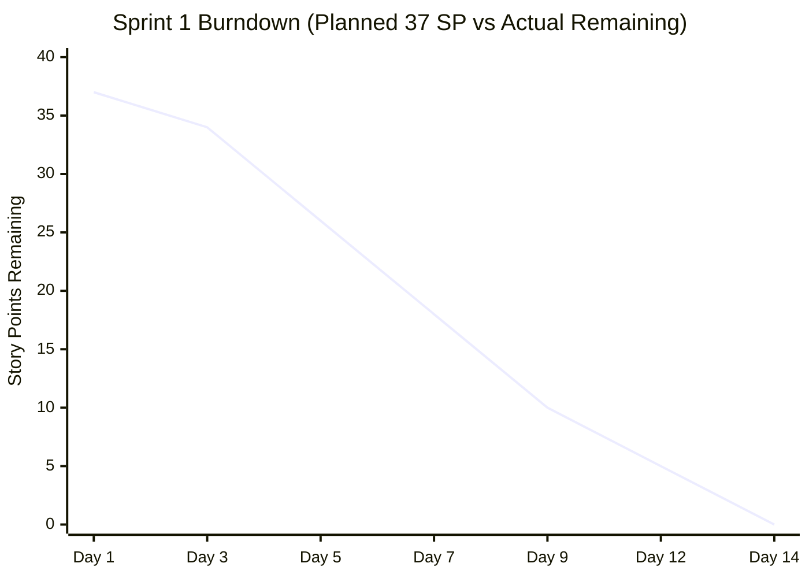
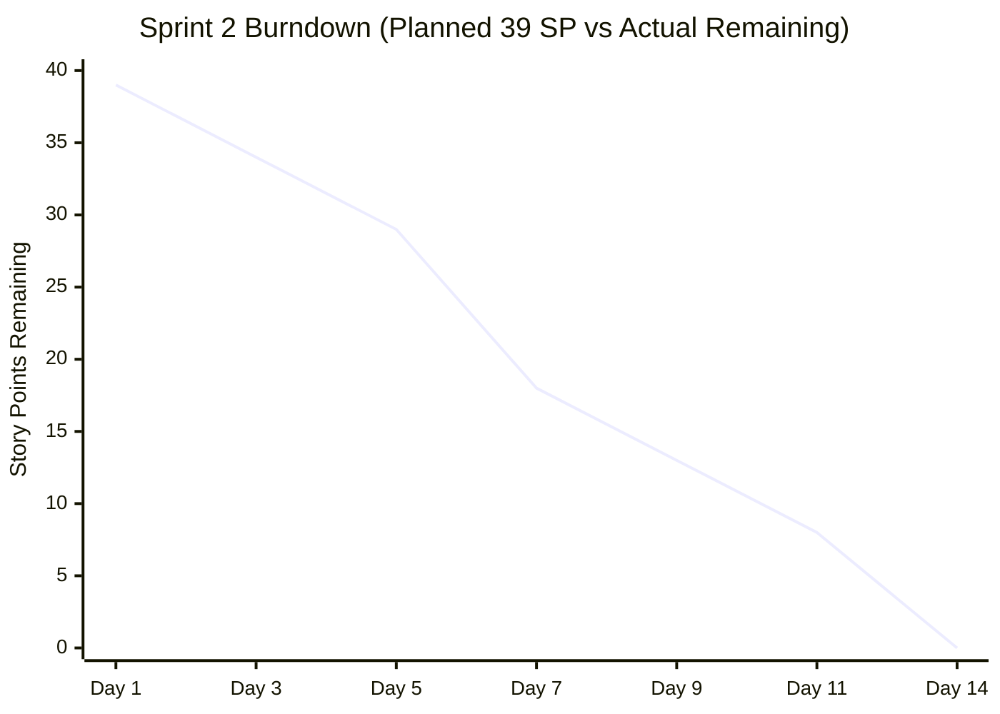

# Phase 10: Sprint Burndown Analysis Evidence
**Course Code**: 20CYS401 — Secure Software Engineering  
**Project**: Online Book Review and Recommendation Platform  

---

## 1. Sprint Burndown Trajectory

### Sprint 1: Core Platform (Oct 8, 2026 – Oct 21, 2026)
- **Total Planned Story Points**: 37 SP
- **Actual Completed Story Points**: 37 SP
- **Completed Stories**: OBRRP-5 (3), OBRRP-6 (5), OBRRP-7 (3), OBRRP-8 (5), OBRRP-9 (3), OBRRP-10 (8), OBRRP-11 (5), OBRRP-12 (5)

| Sprint Day | Date | Remaining Story Points | Completed That Day | Description of Verified Progress |
|---|---|---|---|---|
| Day 1 | Oct 8, 2026 | 37 SP | 0 SP | Sprint planning, architecture baseline, repo setup |
| Day 3 | Oct 10, 2026 | 34 SP | 3 SP | OBRRP-5 (Registration) verified and moved to DONE |
| Day 5 | Oct 12, 2026 | 26 SP | 8 SP | OBRRP-6 (Login - 5 SP) & OBRRP-7 (Logout - 3 SP) DONE |
| Day 7 | Oct 14, 2026 | 18 SP | 8 SP | OBRRP-8 (Search - 5 SP) & OBRRP-9 (Details - 3 SP) DONE |
| Day 9 | Oct 16, 2026 | 10 SP | 8 SP | OBRRP-10 (Rate & Review - 8 SP) verified and DONE |
| Day 12 | Oct 19, 2026 | 5 SP | 5 SP | OBRRP-11 (Edit/Delete Own Reviews - 5 SP) DONE |
| Day 14 | Oct 21, 2026 | 0 SP | 5 SP | OBRRP-12 (Reading List - 5 SP) DONE; Sprint 1 goal reached |

---

## 2. Sprint 2: Security & DevSecOps (Oct 22, 2026 – Nov 4, 2026)
- **Total Planned Story Points**: 39 SP
- **Actual Completed Story Points**: 39 SP
- **Completed Stories**: OBRRP-13 (5), OBRRP-14 (5), OBRRP-15 (8), OBRRP-16 (3), OBRRP-17 (5), OBRRP-18 (5), OBRRP-19 (8)

| Sprint Day | Date | Remaining Story Points | Completed That Day | Description of Verified Progress |
|---|---|---|---|---|
| Day 1 | Oct 22, 2026 | 39 SP | 0 SP | Sprint 2 planning, IDOR attack tree modeling |
| Day 3 | Oct 24, 2026 | 34 SP | 5 SP | OBRRP-13 (Admin Book Management - 5 SP) DONE |
| Day 5 | Oct 26, 2026 | 29 SP | 5 SP | OBRRP-14 (Review Moderation - 5 SP) DONE |
| Day 7 | Oct 28, 2026 | 18 SP | 11 SP | OBRRP-15 (IDOR - 8 SP) & OBRRP-16 (Audit - 3 SP) DONE |
| Day 9 | Oct 30, 2026 | 13 SP | 5 SP | OBRRP-17 (Security Testing - 5 SP) DONE |
| Day 11 | Nov 1, 2026 | 8 SP | 5 SP | OBRRP-18 (CI/CD Pipeline - 5 SP) DONE |
| Day 14 | Nov 4, 2026 | 0 SP | 8 SP | OBRRP-19 (Docker & K8s - 8 SP) DONE; Sprint 2 closed |

