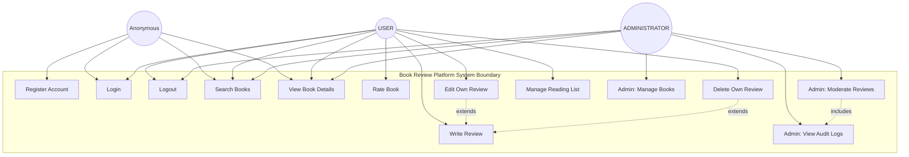

# Phase 3: UML Use Case Diagrams and Analysis
**Course Code**: 20CYS401

---

## 3.1 Use Case Diagram (Mermaid Source)

---

## 3.2 Detailed Use Case Specification: UC-01 — Edit/Delete Own Review

| Field | Value |
|---|---|
| **Use Case ID** | UC-01 (maps to REQ-07, REQ-08) |
| **Name** | Submit, Edit, and Delete Book Review |
| **Primary Actor** | USER |
| **Preconditions** | User is authenticated (valid server-side session); Book exists in catalog |
| **Trigger** | User navigates to book detail page and submits review form |

### Main Success Flow — Submit Review
1. User navigates to `/books/{book_id}`
2. System displays review form (only if user has no existing review for this book)
3. User enters rating (1–5) and review text (5–2000 chars)
4. System validates: rating integer 1–5, text length, CSRF token
5. System creates `Review` record linked to `user_id` and `book_id` (unique constraint)
6. System records `REVIEW_CREATED` audit event
7. System redirects to book detail with success flash message

### Main Success Flow — Edit Review
1. User navigates to `/books/{book_id}` — sees their existing review with Edit form
2. User modifies rating or text and submits form
3. **System verifies `review.user_id == current_user.id` (CTRL-02, server-side)**
4. System validates new content; updates `Review` record
5. System records `REVIEW_UPDATED` audit event
6. System redirects with success flash message

### Alternative Flow — User B Attempts to Edit User A's Review
1. Attacker Bob sends POST `/reviews/{alice_review_id}/edit` with modified credentials
2. **System verifies `review.user_id (alice_id) != current_user.id (bob_id)` → DENIED**
3. System records `UNAUTHORIZED_REVIEW_EDIT_ATTEMPT` with status DENIED
4. System returns flash: "Access denied: You can only edit your own reviews."
5. Database remains unchanged (verified by TEST-05)

### Exception Flows
- **E1**: Rating out of range → validation error, form re-displayed
- **E2**: Review text < 5 chars → validation error
- **E3**: CSRF token missing/invalid → 400 Bad Request

| Field | Value |
|---|---|
| **Postconditions (Success)** | Review persisted; average rating updated; audit logged |
| **Postconditions (Failure)** | Database unchanged; DENIED event logged; actor denied access |
| **Security Controls** | CTRL-01, CTRL-02, CTRL-03, CTRL-04, CTRL-08 |

---

## 3.3 Detailed Use Case Specification: UC-02 — Administrator Moderates Review

| Field | Value |
|---|---|
| **Use Case ID** | UC-02 (maps to REQ-11) |
| **Name** | Administrator Moderates Inappropriate Review |
| **Primary Actor** | ADMINISTRATOR |
| **Preconditions** | Admin is authenticated; Review exists |

### Main Success Flow — Hide Review
1. Admin navigates to `/admin/moderation`
2. System lists all reviews with moderation controls
3. Admin selects a review and provides mandatory moderation reason
4. **System verifies `current_user.is_admin == True` (CTRL-06)**
5. System sets `review.is_moderated = True`, `moderation_reason = reason`, `moderated_by = admin.id`
6. System records `REVIEW_HIDDEN` audit event with admin, timestamp, reason
7. Moderated review no longer appears on public book detail page

### Alternative Flow — Restore Moderated Review
1. Admin selects previously hidden review and clicks "Restore"
2. System clears `is_moderated` flag and `moderation_reason`
3. System records `REVIEW_RESTORED` audit event
4. Review reappears on public listing

### Exception Flow — Non-Admin Attempts Moderation
1. Normal user sends POST `/admin/moderation/{review_id}/moderate`
2. **`@admin_required` decorator detects `current_user.is_admin == False`**
3. System returns HTTP 403 Forbidden (custom error page, no internal details)

| Field | Value |
|---|---|
| **Security Controls** | CTRL-06 (RBAC), CTRL-08 (Audit), CTRL-07 (Error handling) |
| **Evidence** | `tests/test_authorization.py::test_normal_user_denied_admin_routes PASSED` |

---

## 3.4 Scenario Analysis: Submit Book Review and Rating

**Title**: Alice discovers and rates "Threat Modeling: Designing for Security"  
**Actors**: Alice (USER), Bob (Attacker attempting IDOR)

| Step | Actor | Action | System Response | Security Check |
|---|---|---|---|---|
| 1 | Alice | GETs `/books/3` | Returns book detail with review form | Renders Jinja2 escaped content |
| 2 | Alice | POSTs 5-star review with 80-char text | Validates rating (CTRL-04), validates text length, persists Review record, logs audit event | REQ-05, REQ-06, CTRL-08 |
| 3 | Bob | POSTs to `/reviews/{alice_review_id}/edit` with rating=1 | Verifies `review.user_id != bob.id`, returns DENIED, logs UNAUTHORIZED_REVIEW_EDIT_ATTEMPT | CTRL-02, TEST-05 PASS |
| 4 | Alice | POSTs to `/reviews/{alice_review_id}/edit` | Verifies `review.user_id == alice.id`, updates review, logs REVIEW_UPDATED | CTRL-02 |
| 5 | Alice | GETs `/my-shelf` | Returns reading list and Alice's authored reviews — only visible to Alice | CTRL-01, REQ-09 |

**Security Trace**: REQ-07 → UC-01 → DFD-P04 → THR-02 → VUL-01 → ATK-01 → CTRL-02 → TEST-05 → PASSED
