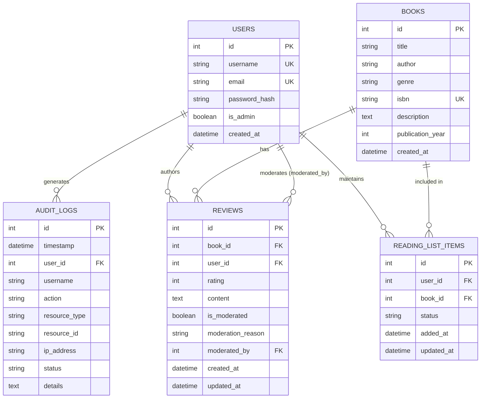
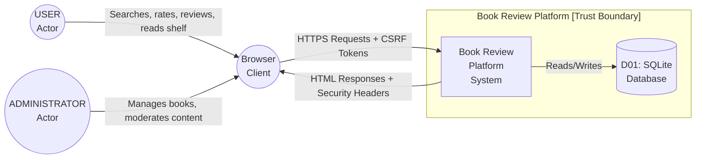
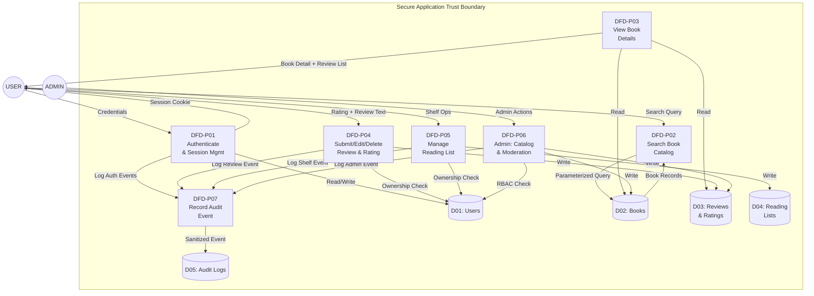
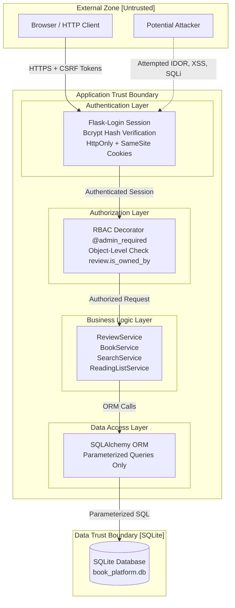

# Phase 4: ER Diagram, DFD, and Trust Boundary Diagram
**Course Code**: 20CYS401

---

## 4.1 Entity-Relationship Diagram (from actual SQLAlchemy models)

**Note**: All entities are directly derived from `app/models/` — User, Book, Review, ReadingListItem, AuditLog.

---

## 4.2 Level-0 DFD (Context Diagram)

---

## 4.3 Level-1 DFD (Process Decomposition)

---

## 4.4 Trust Boundary Diagram

---

## 4.5 Sensitive Information Flows (Min. 3 Assets)

| Asset ID | Flow | Source → Destination | Protection |
|---|---|---|---|
| ASSET-01 (Credentials) | Login: password string → bcrypt.checkpw() → user session | Browser → DFD-P01 → D01 | Bcrypt rounds=12, never stored/logged in plaintext |
| ASSET-04 (Reviews) | Review create: raw text → sanitize_text() → ORM → DB | USER → DFD-P04 → D03 | Length limit, null-byte strip, Jinja2 autoescaping on output |
| ASSET-07 (Admin Privileges) | Admin route: request → @admin_required → is_admin flag check | ADMIN → DFD-P06 → D01 | Server-side RBAC, no client-controllable flag, custom 403 on fail |
