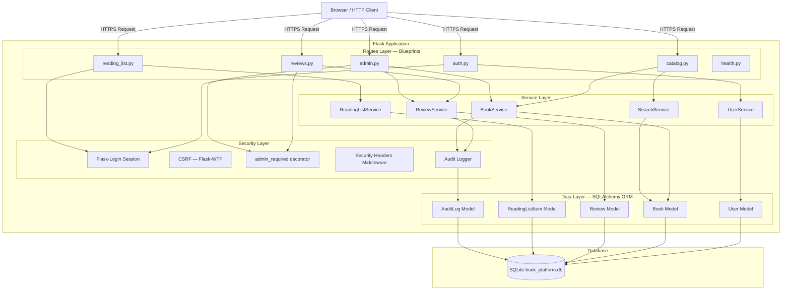
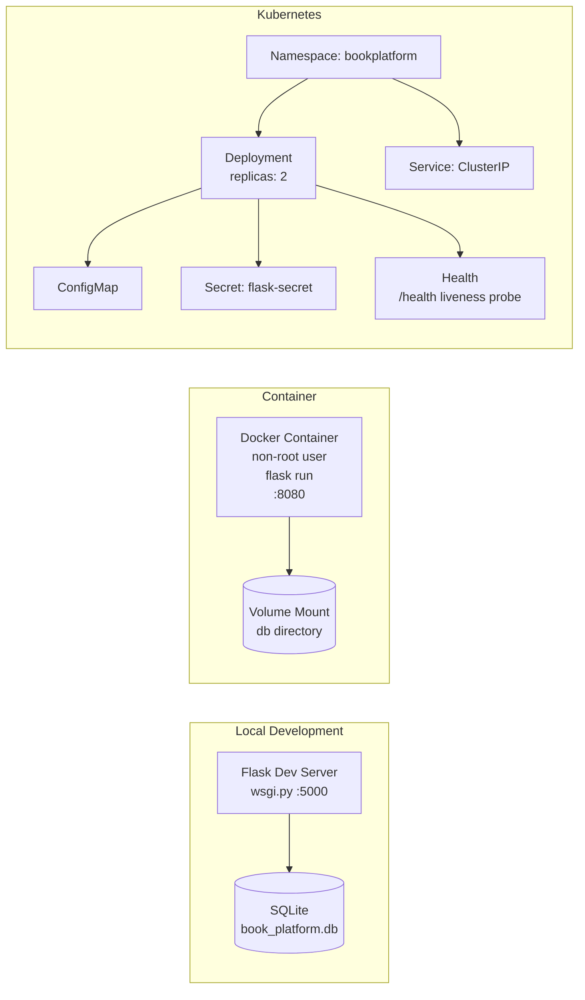

# Phase 5: Architecture and Design
**Course Code**: 20CYS401

---

## 5.1 System Architecture Overview

The platform uses a **four-layer architecture** implemented in Python/Flask:

```
Browser Client
      │
      ▼
┌─────────────────────────────────────────────────────┐
│  PRESENTATION LAYER — Flask Route Blueprints        │
│  auth.py | catalog.py | reviews.py |                │
│  reading_list.py | admin.py | health.py             │
│  Templates: Jinja2 (autoescaping enabled)           │
└─────────────────────────────────────────────────────┘
      │
      ▼
┌─────────────────────────────────────────────────────┐
│  SECURITY CROSS-CUTTING LAYER                       │
│  app/core/security.py — admin_required decorator    │
│  app/core/audit.py — log_audit_event()              │
│  Flask-Login — session management                   │
│  Flask-WTF / WTForms — CSRF protection              │
│  Flask-Talisman equivalent — security headers       │
└─────────────────────────────────────────────────────┘
      │
      ▼
┌─────────────────────────────────────────────────────┐
│  SERVICE LAYER — Business Logic                     │
│  UserService | BookService | SearchService          │
│  ReviewService | ReadingListService                 │
│  (all IDOR/ownership checks live here)              │
└─────────────────────────────────────────────────────┘
      │
      ▼
┌─────────────────────────────────────────────────────┐
│  DATA ACCESS LAYER — SQLAlchemy ORM                 │
│  models: User | Book | Review |                     │
│          ReadingListItem | AuditLog                 │
│  All queries parameterized; no raw string SQL       │
└─────────────────────────────────────────────────────┘
      │
      ▼
┌─────────────────────────────────────────────────────┐
│  PERSISTENCE LAYER                                  │
│  SQLite (local dev) → PostgreSQL (production path)  │
│  instance/book_platform.db                         │
└─────────────────────────────────────────────────────┘
```

---

## 5.2 Layered Architecture Mermaid Diagram



---

## 5.3 Component Inventory

| ID | Component | File | Responsibility |
|---|---|---|---|
| COMP-01 | Application Factory | `app/__init__.py` | Creates Flask app, registers blueprints, sets security headers |
| COMP-02 | Config | `app/config.py` | Environment-based configuration with absolute DB path |
| COMP-03 | Data Models | `app/models/` | ORM entities: User, Book, Review, ReadingListItem, AuditLog |
| COMP-04 | Services | `app/services/` | Business logic, ownership checks, IDOR prevention |
| COMP-05 | Routes | `app/routes/` | HTTP request/response handling, input intake |
| COMP-06 | Security Core | `app/core/security.py` | RBAC decorator, input validators |
| COMP-07 | Audit Core | `app/core/audit.py` | Tamper-evident event logging with secret scrubbing |
| COMP-08 | Templates | `app/templates/` | Jinja2 server-rendered UI with autoescaping |

---

## 5.4 Security Architecture Decisions

| Decision | Rationale | Alternatives Rejected |
|---|---|---|
| **Server-side sessions** via Flask's signed cookie | Prevents client-side session tampering; session contents are not readable by client | JWT — introduces signature algorithm confusion attacks, token revocation complexity |
| **Bcrypt rounds=12** | Computationally expensive to brute-force | MD5, SHA-256 — fast hash functions not suitable for password storage |
| **Object-level authorization in Service layer** (not route layer) | Authorization logic testable independently; cannot be bypassed by changing HTTP method | Route-layer check only — easily bypassed by alternate endpoints |
| **SQLAlchemy ORM** for all queries | Parameterized by design; eliminates SQL injection class | Raw `db.execute(f"...")` — vulnerable to SQLi |
| **CSRF via Flask-WTF** hidden form tokens | Prevents cross-site form submission from malicious origins | None / `SameSite=Lax` only — insufficient for some browser versions |

---

## 5.5 Deployment Architecture


