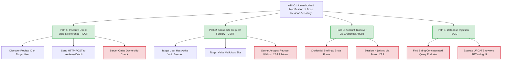

# Phase 8: Attack Tree Analysis
**Course Code**: 20CYS401 | **Project**: Online Book Review and Recommendation Platform

---

## 8.1 Primary Attack Goal (ATK-01)

**Goal**: **Unauthorized Modification of Book Review and Rating Data (Integrity Breach)**

Attacking book review integrity alters public trust, misrepresents literature, and destroys the value of the platform. This attack tree analyzes the potential pathways an adversary could exploit to tamper with book reviews.

---

## 8.2 Attack Tree Representation (Mermaid AND/OR Tree)



---

## 8.3 Node Explanations and Mitigations

### Path 1: IDOR Exploitation (VUL-01)
- **Vulnerability**: If the application blindly queries `Review.query.get(review_id)` and commits updates using request form data without verifying if `review.user_id == current_user.id`.
- **Mitigation (CTRL-02)**: The service layer explicitly enforces:
  ```python
  if not review.is_owned_by(user_id):
      log_audit_event("UNAUTHORIZED_REVIEW_EDIT_ATTEMPT", status="DENIED")
      return False, "Access denied: You can only edit your own reviews."
  ```
- **Verification**: Verified by `tests/test_authorization.py::test_user_b_cannot_edit_user_a_review` (PASS). Demonstrated on branch `demo/idor-before` where omitting this check succeeded, and on `main` where it is strictly blocked.

### Path 2: CSRF Exploitation (VUL-02)
- **Vulnerability**: An attacker lures an authenticated user to submit a hidden POST form targeting `/reviews/<id>/edit`.
- **Mitigation (CTRL-01)**: Flask-WTF generates and validates cryptographically secure CSRF tokens per user session. All POST requests lacking or providing mismatched tokens are aborted with HTTP 400.

### Path 3: Account Takeover (VUL-03 & VUL-04)
- **Vulnerability**: Weak passwords allow brute-forcing; lack of XSS protection enables session hijacking.
- **Mitigation (CTRL-01, CTRL-03, CTRL-09)**: Password complexity validation, bcrypt password hashing with 12 salt rounds, strict `HttpOnly` and `SameSite=Lax` cookies, and Jinja2 contextual escaping.

### Path 4: Database Injection (VUL-06)
- **Vulnerability**: Using string interpolation in SQL queries allows executing arbitrary UPDATE statements.
- **Mitigation (CTRL-05)**: Standardized on SQLAlchemy ORM parameterized queries across all database access layers.
