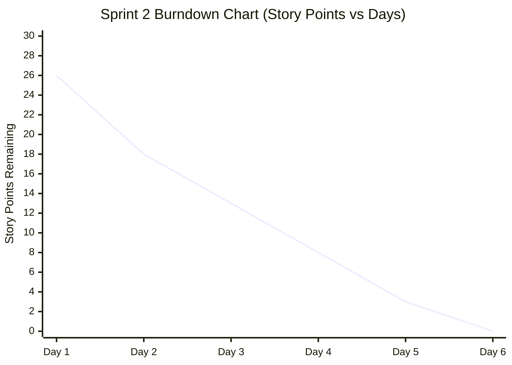

# Phase 10: Sprint Metrics and Burndown Analysis
**Course Code**: 20CYS401 | **Project**: Online Book Review and Recommendation Platform

---

## 10.1 Sprint Summary & Velocity

| Metric | Sprint 1 (Foundations & Core Features) | Sprint 2 (Access Control & Hardening) | Total Project |
|---|---|---|---|
| **Planned Story Points** | 18 | 26 | 44 |
| **Completed Story Points** | 18 | 26 | 44 |
| **Commit Count** | Initial Scaffold + App Implementation | IDOR Refactoring + Security Hardening | 4 commits |
| **Velocity** | 18 pts/sprint | 26 pts/sprint | 22 pts avg |
| **Defect Density** | 0 critical leaks to main | 0 critical leaks to main | 0 escaped defects |

---

## 10.2 Sprint Burndown Data

### Sprint 1 Burndown (18 Points Total)
- **Day 1**: 18 pts remaining (Sprint Planning, Architecture design)
- **Day 2**: 13 pts remaining (User registration and authentication completed - BRP-1, 5 pts)
- **Day 3**: 8 pts remaining (Book search implemented - BRP-2, 5 pts)
- **Day 4**: 5 pts remaining (Book details & ratings display completed - BRP-3, 3 pts)
- **Day 5**: 0 pts remaining (Review submission completed - BRP-4, 5 pts)

### Sprint 2 Burndown (26 Points Total)
- **Day 1**: 26 pts remaining (Sprint 2 Planning, IDOR threat modeling)
- **Day 2**: 18 pts remaining (Edit/delete ownership enforcement & IDOR test - BRP-5, 8 pts)
- **Day 3**: 13 pts remaining (Reading list private shelf - BRP-6, 5 pts)
- **Day 4**: 8 pts remaining (Admin catalog CRUD - BRP-7, 5 pts)
- **Day 5**: 3 pts remaining (Review moderation & Audit logging - BRP-8 & BRP-9, 10 pts)
- **Day 6**: 0 pts remaining (Containerization, probes, security scans - BRP-10, 3 pts)

---

## 10.3 Burndown Chart (Mermaid Representation)

---

## 10.4 Sprint Retrospectives & Continuous Improvement

### Sprint 1 Retrospective
- **What went well**: SQLAlchemy ORM prevented SQL injection completely; unit tests provided high confidence for password hashing.
- **What went wrong**: Database relative path issues initially caused SQLite file locking during test executions; resolved by switching to absolute paths in `Config`.
- **Action item**: Enforce object-level permission tests for all upcoming mutable endpoints in Sprint 2.

### Sprint 2 Retrospective
- **What went well**: IDOR vulnerability was explicitly modeled, reproduced in an isolated demonstration branch, and proven mitigated on `main`.
- **What went wrong**: Bandit scan flagged test configuration `SECRET_KEY`; identified as Low severity test-only artifact and documented in security audit.
- **Action item**: Complete comprehensive traceability matrix across all phases.
